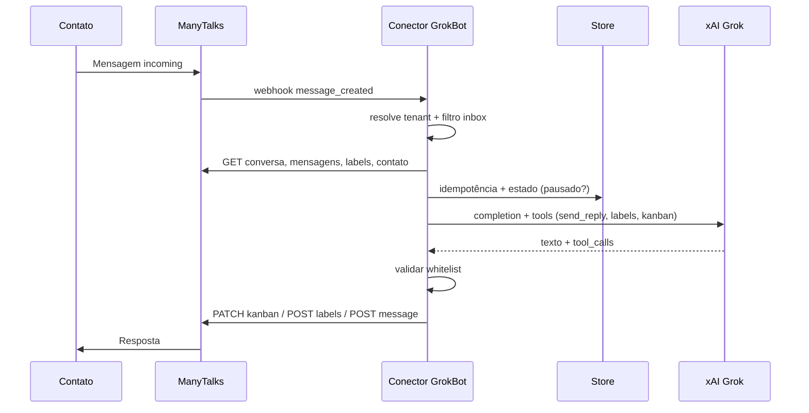

# Plano — GrokBot × ManyTalks

**Objetivo:** conector multi-tenant em que **cada “chat GrokBot” = um `account_id` ManyTalks**, com **inboxes selecionadas**, e o Grok executa **apenas**:

1. **Atender** — enviar mensagem pública ao contato  
2. **Etiquetas** — atualizar labels da conversa (com merge)  
3. **Kanban** — mover/atualizar card no pipeline configurado  

**Referências:** [API-Manytalks.md](./API-Manytalks.md) · [PRODUTO-GROK-MANYTALKS.md](./PRODUTO-GROK-MANYTALKS.md) (painel, biblioteca, Asaas, dashboard) · Swagger: https://app.manytalks.com.br/swagger · Base: `https://app.manytalks.com.br`

**Extensões de produto (ver PRODUTO):** tools Asaas (link / PIX), automação pós-pagamento, painel com kanban+matriz, dashboard por conta **somente com senha**, 1 conta Asaas por GrokBot com **split no Asaas**.

---

## 1. Modelo de produto

```text
GrokBot Tenant A  →  manytalks_account_id: 42
                        inbox_ids: [3, 7, 12]
                        token + prompt + regras + kanban/labels

GrokBot Tenant B  →  manytalks_account_id: 99
                        inbox_ids: [1]
                        ...
```

| Conceito | Significado |
|----------|-------------|
| **GrokBot tenant** | Configuração lógica no conector (1 por cliente seu / 1 account ManyTalks) |
| **Account ManyTalks** | Tenant no painel (`/app/accounts/{id}`) |
| **Inbox** | Canal; só as listadas em `enabled_inbox_ids` disparam o bot |
| **Conversa** | Identificada por `display_id` na API (**não** ID interno do banco) |

---

## 2. Escopo fechado (o que o Grok faz e não faz)

### Permitido

| Ação | API |
|------|-----|
| Responder ao contato | `POST .../conversations/{conversation_id}/messages` (`outgoing`, `private: false`) |
| Etiquetas da conversa | `GET` + merge + `POST .../conversations/{id}/labels` |
| Kanban do contato | `PATCH .../contacts/{contact_id}/pipeline_positions/{pipeline_id}` |

### Leitura (contexto, sem efeito colateral destrutivo)

- `GET .../conversations/{conversation_id}`
- `GET .../conversations/{conversation_id}/messages`
- `GET .../contacts/{contact_id}`
- `GET .../conversations/{conversation_id}/labels`
- `GET .../custom_attribute_definitions?attribute_model=contact_attribute` (cache de pipelines/estágios)

### Explicitamente fora do escopo

Atribuição (`assignments`), status (`toggle_status`), prioridade, notas privadas, workflows, Capitão, campanhas, CRUD de pipeline/labels da conta, apagar mensagens, encaminhar, resolver conversa via API.

**Handoff humano:** apenas via **etiqueta** (ex.: `escalar-humano`) e/ou **estágio kanban** (ex.: `Negociação humana`); o conector pode **pausar** o bot ao detectar essas marcas.

---

## 3. Credenciais e onboarding (por account)

Checklist por novo GrokBot:

| # | Item |
|---|------|
| 1 | `manytalks_account_id` |
| 2 | **Personal Access Token** (Perfil → Access Token). Preferir usuário com permissão nas inboxes e **CRM/Kanban** (`editor` ou `admin` no pipeline) |
| 3 | `enabled_inbox_ids[]` |
| 4 | Webhook na conta apontando para o conector |
| 5 | `system_prompt` + opcional base de conhecimento (texto/arquivos) |
| 6 | **xAI API key** (global ou por tenant) + modelo |
| 7 | Whitelist: `allowed_label_titles`, `kanban.pipeline_id`, `allowed_stage_ids` |
| 8 | Capitão **desligado** nas inboxes atendidas pelo Grok (evitar duas IAs) |

### Webhook recomendado

`POST /api/v1/accounts/{account_id}/webhooks`

```json
{
  "webhook": {
    "url": "https://SEU_CONECTOR/hooks/manytalks",
    "subscriptions": [
      "message_created",
      "conversation_status_changed",
      "conversation_updated",
      "contact_kanban_stage_changed"
    ]
  }
}
```

`contact_kanban_stage_changed` serve para **pausar** o bot em estágios finais, não para o Grok responder sem mensagem nova.

---

## 4. Arquitetura



**Responsabilidades:**

- **ManyTalks:** eventos + API REST  
- **Conector:** roteamento por `account_id`, filiais de inbox, merge de labels, validação de estágios, idempotência, logs  
- **Grok:** raciocínio + decisão de chamar tools (nunca chama ManyTalks diretamente)

---

## 5. Schema de configuração (tenant)

```json
{
  "id": "uuid-grokbót-tenant",
  "manytalks_base": "https://app.manytalks.com.br",
  "manytalks_account_id": 42,
  "api_access_token_ref": "env ou vault — nunca commitar",
  "enabled_inbox_ids": [3, 7, 12],
  "enabled": true,
  "xai": {
    "model": "grok-2-latest",
    "api_key_ref": "env ou vault",
    "max_history_messages": 30,
    "temperature": 0.4
  },
  "prompt": {
    "system": "Ver seção 8 — template",
    "knowledge_ref": "opcional: arquivo ou URL interna"
  },
  "labels": {
    "allowed_titles": ["lead", "quente", "frio", "escalar-humano", "grok-ativo"],
    "merge_strategy": "union_with_remove",
    "on_labels_pause_bot": ["escalar-humano"]
  },
  "kanban": {
    "pipeline_id": 55,
    "allowed_stage_ids": ["Novo", "Qualificado", "Proposta"],
    "stages_that_pause_bot": ["Fechado", "Perdido", "Ganho"],
    "allow_deal_value": true,
    "allow_win_lost_metadata": false
  },
  "rules": {
    "only_incoming_messages": true,
    "ignore_private": true,
    "conversation_statuses": ["open", "pending"],
    "only_when_unassigned": false,
    "execute_tools_before_reply": true
  },
  "webhook_path_suffix": "optional /hooks/manytalks/{tenant_id}"
}
```

---

## 6. Handler `message_created`

### Filtros (ordem sugerida)

1. Resolver **tenant** por `account_id` no payload (ou URL dedicada).  
2. Tenant `enabled`?  
3. `inbox_id` ∈ `enabled_inbox_ids`?  
4. Mensagem **incoming** do contato; não `private`; não eco de mensagem que o conector acabou de enviar.  
5. `conversation_id` (display_id) + **idempotência:** `message.id` já processado? → 204.  
6. Conversa em `rules.conversation_statuses`?  
7. Se `only_when_unassigned`: `meta.assignee` ausente?  
8. Estado `bot_paused` (etiqueta, estágio ou flag manual)?  

### Montagem de contexto para o Grok

Payload lógico (montado pelo conector):

```json
{
  "account_id": 42,
  "conversation": {
    "id": 120,
    "inbox_id": 3,
    "status": "open",
    "labels": ["lead"],
    "custom_attributes": {}
  },
  "contact": {
    "id": 456,
    "name": "Ana",
    "pipeline_positions": [
      {
        "pipeline_id": 55,
        "stage_id": "Novo",
        "deal_value": null
      }
    ]
  },
  "messages": [
    { "role": "user", "content": "Quero orçamento" }
  ],
  "new_message": {
    "id": 9001,
    "content": "Quero orçamento"
  }
}
```

Converter `messages` do ManyTalks para papéis: `incoming` → `user`, `outgoing` (agente/bot) → `assistant`.

---

## 7. Tools (function calling) — contrato

O conector registra **somente** estas tools na chamada xAI:

### 7.1 `send_reply`

```json
{
  "name": "send_reply",
  "description": "Envia resposta pública ao contato na conversa atual.",
  "parameters": {
    "type": "object",
    "properties": {
      "content": {
        "type": "string",
        "description": "Texto da mensagem ao cliente."
      }
    },
    "required": ["content"]
  }
}
```

**Efeito:** `POST .../messages` com `message_type: "outgoing"`, `private: false`, `content_type: "text"`.  
**WhatsApp:** se o conector detectar canal que exige template, falhar a tool e instruir no system prompt a resposta curta compatível com sessão — ou mapear `template_params` em fase posterior.

---

### 7.2 `set_conversation_labels`

```json
{
  "name": "set_conversation_labels",
  "description": "Adiciona ou remove etiquetas da conversa. Nunca envia lista parcial sem merge.",
  "parameters": {
    "type": "object",
    "properties": {
      "add": {
        "type": "array",
        "items": { "type": "string" },
        "description": "Etiquetas a incluir (somente títulos permitidos)."
      },
      "remove": {
        "type": "array",
        "items": { "type": "string" },
        "description": "Etiquetas a remover."
      }
    },
    "required": []
  }
}
```

**Algoritmo no conector:**

```text
atual := GET labels da conversa
add    := filtrar por allowed_titles
remove := conjunto validado
novo   := (atual ∪ add) \ remove
POST { "labels": sort(novo) }
```

Se `novo` intersecta `on_labels_pause_bot` → setar `bot_paused = true` para a conversa.

---

### 7.3 `move_kanban_card`

```json
{
  "name": "move_kanban_card",
  "description": "Atualiza estágio e opcionalmente valor do negócio no pipeline configurado.",
  "parameters": {
    "type": "object",
    "properties": {
      "stage_id": {
        "type": "string",
        "description": "Nome exato da coluna (ex.: Proposta)."
      },
      "deal_value": {
        "type": "number",
        "description": "Valor do negócio, se aplicável."
      },
      "position": {
        "type": "integer",
        "description": "Ordem na coluna; default 0."
      }
    },
    "required": ["stage_id"]
  }
}
```

**Validação:**

- `stage_id` ∈ `allowed_stage_ids` (cache de `attribute_values.stage_order` do pipeline).  
- `pipeline_id` fixo no tenant (`kanban.pipeline_id`).  
- Se `allow_win_lost_metadata: false` → não enviar `metadata.win_lost`.  
- `primary_conversation_id` em metadata: usar `conversation.display_id` se o conector preencher automaticamente.

**Efeito:**

```http
PATCH /api/v1/accounts/{account_id}/contacts/{contact_id}/pipeline_positions/{pipeline_id}
```

Se novo estágio ∈ `stages_that_pause_bot` → `bot_paused = true`.

---

## 8. System prompt (template por account)

Substituir `{{...}}` na criação do tenant.

```text
Você é o assistente de atendimento da empresa no ManyTalks (account {{account_id}}).
Canais atendidos: inboxes {{inbox_ids}}.

Você só pode agir através destas ferramentas:
- send_reply: falar com o cliente
- set_conversation_labels: organizar a conversa
- move_kanban_card: atualizar o funil de vendas

Regras obrigatórias:
1. Seja claro, educado e objetivo em português (Brasil), salvo o cliente escrever em outro idioma.
2. Não invente preços, prazos ou políticas: use apenas a base de conhecimento abaixo; se não souber, diga que vai verificar e use a etiqueta escalar-humano.
3. Etiquetas permitidas: {{allowed_labels}}. Significados: {{label_meanings}}.
4. Kanban: pipeline {{pipeline_name}} (id {{pipeline_id}}). Você só pode mover para: {{allowed_stages}}. Estágio atual do contato: {{current_stage}}.
5. Ao identificar intenção comercial, qualifique o lead (perguntas objetivas) e mova o card para o estágio adequado.
6. Use escalar-humano e/ou estágio {{handoff_stage}} quando o cliente pedir humano, reclamar, ou o caso for sensível/jurídico.
7. Nunca mencione ferramentas, APIs, Grok ou “sistema interno”.
8. Chame move_kanban_card e set_conversation_labels quando fizer sentido, não apenas no final; em seguida send_reply.

Base de conhecimento:
{{knowledge}}
```

---

## 9. Estado persistido

| Chave | Uso |
|-------|-----|
| `(tenant_id, conversation_id)` | `last_processed_message_id`, `bot_paused`, `updated_at` |
| Opcional | `rolling_summary` se histórico > `max_history_messages` |

Tabela sugerida: `conversation_bot_state`.

---

## 10. Idempotência e loops

- Chave: `tenant_id + message.id` (ManyTalks).  
- Ignorar webhooks de mensagens **outgoing** criadas pelo token do bot (comparar `sender` ou marcar `source_id` interno).  
- Retry do ManyTalks: mesmo `message.id` não reprocessa.

---

## 11. Erros comuns (ManyTalks)

| Situação | Ação |
|----------|------|
| 404 na conversa | Verificar **display_id** |
| 403 no kanban | Token sem permissão CRM; ajustar usuário ou pipeline |
| 422 em labels | Título inválido; restringir à whitelist |
| Labels sumiram | POST substitui tudo — **sempre** merge após GET |
| Duas IAs respondendo | Desativar Capitão nas inboxes do Grok |

---

> **Entrega integral (sem MVP):** cronograma, módulos, banco, telas e UAT — [PLANO-COMPLETO.md](./PLANO-COMPLETO.md).

## 12. Fases de implementação (referência técnica; execução unificada no plano completo)

| Fase | Entrega | Critério de aceite |
|------|---------|-------------------|
| **1** | Webhook + filtro inbox + `send_reply` | Mensagem incoming em inbox permitida recebe resposta |
| **2** | Merge de labels + whitelist | Labels existentes preservadas; `escalar-humano` pausa bot |
| **3** | `move_kanban_card` + cache de estágios | Card muda de coluna só dentro de `allowed_stage_ids` |
| **4** | `contact_kanban_stage_changed` + logs estruturados | Movimento manual para estágio “fechado” pausa bot |
| **5** | Painel/API CRUD de tenants | Cadastro account, inboxes, teste de token |

---

## 13. Variáveis de ambiente (conector)

```env
MANYTALKS_BASE=https://app.manytalks.com.br
XAI_API_KEY=
DATABASE_URL=
WEBHOOK_SIGNING_SECRET=   # se ManyTalks/sua camada validar assinatura
ENCRYPTION_KEY=           # para tokens por tenant em repouso
```

---

## 14. Próximo passo de código

Stack sugerida (a definir): **FastAPI** ou **Node (Hono/Express)** com:

- `POST /hooks/manytalks` (ou por tenant)  
- Cliente HTTP ManyTalks (headers `api_access_token`)  
- Worker opcional para fila  
- Módulo `xai` com tools 7.1–7.3  

Este documento é a **fonte de verdade** do produto até existir OpenAPI do conector.

---

*Alinhado a API-Manytalks.md (2025-11-13). Kanban, etiquetas e display_id seguem as seções 4, 5, 6, 7 e 9 do guia.*
